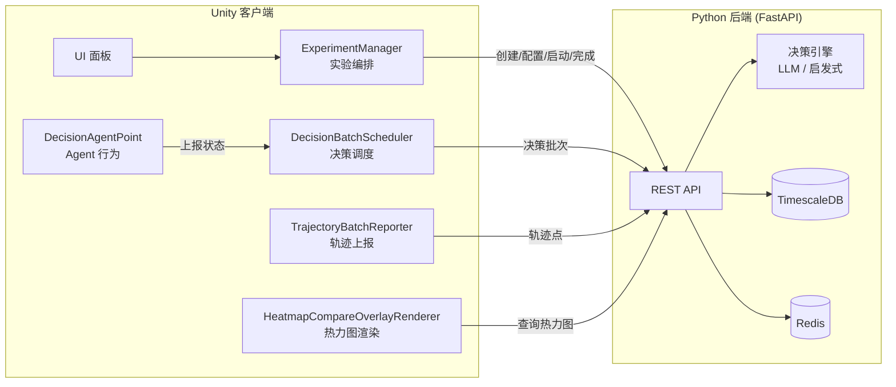
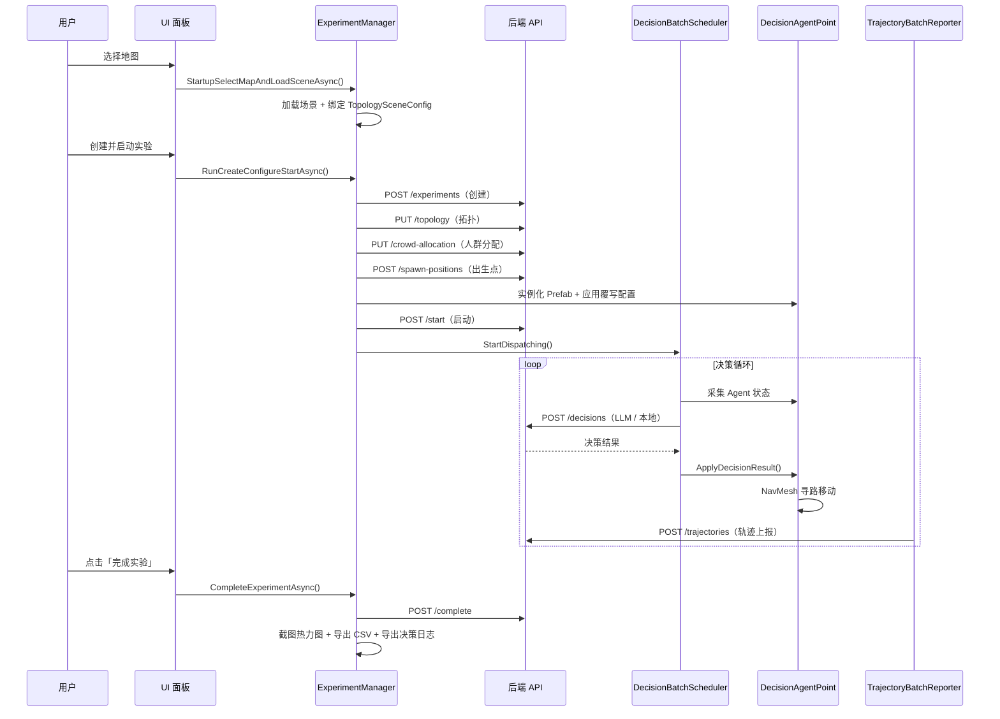
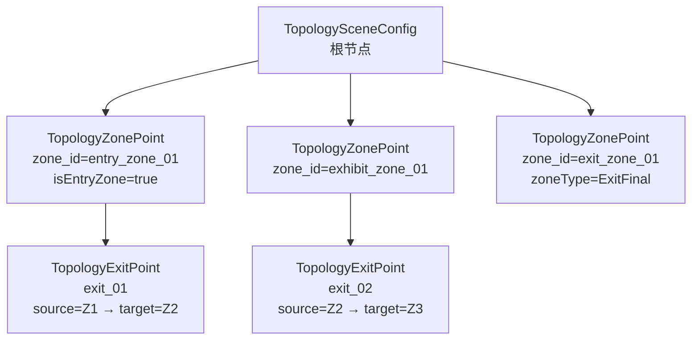

# 人群流动模拟系统 — 项目使用说明

> 版本：v1.0
> 适用工程：`wyy13576106911dots`（Unity 客户端 + Python FastAPI 后端）
> 本文档面向交付与运维人员，覆盖运行流程、关键参数、场景配置与常见问题排查。

---

## 目录

1. [系统概述](#1-系统概述)
2. [环境准备](#2-环境准备)
3. [应用运行流程与逻辑](#3-应用运行流程与逻辑)
4. [决策机制详解](#4-决策机制详解)
5. [关键类与参数配置](#5-关键类与参数配置)
6. [拓扑配置：TopologySceneConfig / ZonePoint / ExitPoint](#6-拓扑配置topologysceneconfig--zonepoint--exitpoint)
7. [FixedPathConfigSO 使用指南](#7-fixedpathconfigso-使用指南)
8. [输出产物说明](#8-输出产物说明)
9. [运行时 UI 面板](#9-运行时-ui-面板)
10. [常见问题排查](#10-常见问题排查)
11. [附录 A：快捷操作菜单](#附录-a快捷操作菜单contextmenu)
12. [附录 B：推荐场景配置顺序](#附录-b推荐场景配置顺序首次搭建)

**相关文档**：

- [《后端启动指南.md》](./后端启动指南.md) — 后端环境搭建与启动
- [《后续开发与拓展建议.md》](./后续开发与拓展建议.md) — 缺陷清单、架构改进与迭代规划
- [《人群流动决策逻辑.md》](./人群流动决策逻辑.md) — 本地评分模型公式推导

---

## 1. 系统概述

本系统用于**人群流动仿真**：在 Unity 场景中生成一批虚拟行人（Agent），由**决策引擎**为每个 Agent 选择下一个要前往的区域，Agent 依据决策结果寻路移动，同时把轨迹上报给后端，最终产出**热力图**、**路径轨迹**与**决策日志**等分析产物。

### 1.1 整体架构



### 1.2 技术要点

| 项 | 说明 |
|----|------|
| 异步模型 | 全部网络请求使用 **UniTask**（`Cysharp.Threading.Tasks`） |
| 寻路 | Unity **NavMeshAgent** |
| 后端地址 | 默认 `http://127.0.0.1:8987` |
| 决策接口 | `POST /api/v1/experiments/{id}/decisions` |
| 轨迹接口 | `POST /api/v1/experiments/{id}/trajectories` |
| 热力图接口 | `POST /api/v1/experiments/{id}/heatmap`、`.../heatmap/compare` |
| 路径接口 | `GET /api/v1/experiments/{id}/path-traces` |

---

## 2. 环境准备

### 2.1 Unity 端

- Unity 版本：与工程 `ProjectSettings/ProjectVersion.txt` 保持一致
- 必需包：**TextMeshPro**、**UniTask**、**NavMesh**（AI Navigation）
- 场景需加入 **Build Settings**（`File → Build Settings → Scenes In Build`），否则地图加载会失败

### 2.2 后端

后端启动、数据库迁移与依赖安装请参考同目录下的 **《后端启动指南.md》**。简要流程：

```bash
# 1. 首次初始化（仅一次）
/opt/homebrew/bin/python3.12 -m venv backend/.venv
backend/.venv/bin/python -m pip install -U pip
backend/.venv/bin/python -m pip install -e "backend[dev]"
cp backend/.env.local.example backend/.env.local

# 2. 数据库迁移
cd backend
APP_ENV=local PYTHONPATH=.. .venv/bin/python -m alembic -c alembic.ini upgrade head

# 3. 启动 API（终端 A）
APP_ENV=local PYTHONPATH=.. .venv/bin/python -m backend

# 4. 启动 worker（终端 B）
APP_ENV=local PYTHONPATH=.. .venv/bin/python -m backend run-maintenance-worker --without-scheduler
```

> **注意**：后端必须**先启动**，Unity 才能成功创建实验。启动后可用健康检查接口验证。

---

## 3. 应用运行流程与逻辑

### 3.1 端到端流程



### 3.2 各阶段详细说明

#### 阶段一：启动选图（Startup）

1. `StartupMapSelectionPanel` 列出 `ExperimentManager.startupMapConfigs` 中的地图
2. 点击「加载选中地图」→ `StartupSelectMapAndLoadSceneAsync()`
3. 场景加载完成后触发 `HandleSceneLoaded`：
   - `TryApplyPendingStartupSelection()` — 记录 map_id 与当前场景名
   - `TryAutoBindTopologySceneConfig()` — **自动查找并绑定当前场景中的 `TopologySceneConfig`**
4. 绑定成功后 `startupStatus` 会显示 `TopologySceneConfig bound: <名称>`

> 绑定拓扑配置是关键一步：后续所有拓扑上传、出口查找、Agent 自动生成候选出口都依赖它。

#### 阶段二：创建与配置（Create / Configure）

`RunCreateConfigureStartCoreAsync()` 依次执行：

| 步骤 | 接口 | 说明 |
|------|------|------|
| 同步人群模板 | `GET /crowd-types` | 由 `CrowdTypeTemplateStartupService` 完成，缓存到 `runtimeCrowdTypeTemplates` |
| 创建实验 | `POST /experiments` | 携带 `llm_config`（模型、温度、最大 token、超时）与 `decision_config`（批间隔、批大小、fallback 开关） |
| 上传拓扑 | `PUT /experiments/{id}/topology` | 由 `TopologySceneConfig.TryBuildTopologyRequest()` 生成 zones + exits |
| 上传人群分配 | `PUT /experiments/{id}/crowd-allocation` | 三种分配模式（见 5.1.4） |

#### 阶段三：生成出生点（Spawn）

1. `POST /experiments/{id}/spawn-positions` 返回每个 Agent 的 `agent_id / type_id / zone_id / position / rotation_y`
2. `InstantiateSpawnedPrefabs()` 按 `spawnPrefabDatabase` 中的类型 → Prefab 映射实例化
3. 每个实例化对象上：
   - `ApplySpawnContext()` 写入身份与初始区域
   - `TryAssignOverrideToAgent()` **按 `FixedPathConfigSO` 分配覆写模式**
   - `ResolveSpawnPosition()` 通过 `NavMesh.SamplePosition` 吸附到导航网格

#### 阶段四：启动与决策（Start / Decision）

1. `POST /experiments/{id}/start` → 状态变为 `Running`，`runningExperimentId` 被设置
2. `TryStartDecisionScheduler()` 启动 `DecisionBatchScheduler`
3. 调度器进入循环（`Update()` 驱动）：
   - **采集阶段**：`ProcessCollectPassTimeSlice()` 分批遍历所有 Agent，构建决策请求并缓存
   - **派发阶段**：到达 `nextDispatchAtTime` 且 `CanStartDispatchRequest()` 为真时，执行 `DispatchNowAsync()`
   - **应用阶段**：`ApplyDecisionResultsAsync()` 把结果写回每个 `DecisionAgentPoint`
4. Agent 收到决策后通过 NavMesh 移动到目标区域；到达后重新进入「需要决策」状态

#### 阶段五：完成与导出（Complete）

`POST /experiments/{id}/complete` 成功后依次执行：

1. `TryStopDecisionScheduler()` — 停止调度
2. `TryCaptureHeatmapLayersOnCompleteAsync()` — 逐图层截图 + 导出 PathTraces CSV
3. `TryExportDecisionTranscriptOnComplete()` — 导出决策日志文本

全部产物路径与格式见 [第 8 节](#8-输出产物说明)。

---

## 4. 决策机制详解

### 4.1 三种派发模式（`DecisionDispatchMode`）

| 模式 | 枚举值 | 行为 | 适用场景 |
|------|--------|------|----------|
| **LlmOnly** | 0 | 所有 Agent 的最终决策**必须**来自后端 LLM。后端不可用时会等待冷却结束，不做本地兜底 | 需要纯模型决策数据的正式实验 |
| **LocalOnly** | 1 | 完全使用本地 `LocalCrowdDecisionEngine` 评分，不请求后端 | 离线调试、压测、无网络环境 |
| **HybridPreferLlm** | 2 | **默认**。优先请求 LLM；若上一批请求仍在飞行中或后端处于冷却期，则本批走本地评分兜底 | 需要稳定性与吞吐的常规实验 |

> `DecisionBatchScheduler.IsLlmOnly` 属性用于判断当前是否处于 LLM Only 模式（导出的 `decision_mode` 列会据此统一为 `llm`）。

### 4.2 本地评分模型（`LocalCrowdDecisionEngine.TrySelectBestExit`）

当走本地决策时，为每个候选出口计算 5 个子评分并加权求和：

$$
totalScore = w_{algo}\cdot S_{algo} + w_{crowd}\cdot S_{crowd} + w_{dist}\cdot S_{dist} + w_{exit}\cdot S_{exit} + w_{attr}\cdot S_{attr}
$$

$$
finalScore = \frac{totalScore}{w_{algo}+w_{crowd}+w_{dist}+w_{exit}+w_{attr}},\qquad confidence = \text{Clamp01}(finalScore)
$$

若权重之和 ≤ 0，退化为纯算法评分。

| 维度 | 公式 | 含义 |
|------|------|------|
| 算法评分 $S_{algo}$ | 直接用出口 DTO 的 `algorithm_score` | 基于静态地图配置（吸引力 + 容量） |
| 拥挤度评分 $S_{crowd}$ | $1 - \dfrac{load + inflow + 1}{capacity}$ | 目标区域越拥挤分越低 |
| 距离评分 $S_{dist}$ | $\dfrac{1}{1 + d / d_{norm}}$ | NavMesh 路径距离，不可达时回退直线距离 |
| 出口通行评分 $S_{exit}$ | $\dfrac{c}{c + c_{norm}}$ | 出口每秒通行能力 |
| 吸引力评分 $S_{attr}$ | 人群类型对目标区域类型的偏好（经 `contrast` 放大） | 体现「游客爱去展区」这类差异 |

> 同一批次内，Agent 决策后会**实时更新** `currentZonePopulation`（减 1）与 `predictedTargetInflow`（加 1），避免同批 Agent 看到虚高人数。详细公式推导见 `docs/人群流动决策逻辑.md`。

### 4.3 决策覆写模式（`DecisionOverrideMode`）

| 模式 | 值 | 行为 |
|------|-----|------|
| `Normal` | 0 | 走正常决策流程 |
| `FixedPath` | 1 | **不参与决策**，按配置的区域 ID 列表**顺序循环**移动 |
| `Random` | 2 | **不参与决策**，每次从候选区域列表**随机**挑一个 |

- 在 **非 LLM Only** 模式下：覆写 Agent 会被**移出决策批次**，直接应用覆写决策
- 在 **LLM Only** 模式下：覆写 Agent **保留在批次中**，但会把其目标出口的 `algorithm_score` 强制置为 `1`（其余置 `0`），并把 `algorithm_recommendation` 设为该出口，**引导 LLM 按预期选择**，最终以 LLM 返回为准

---

## 5. 关键类与参数配置

### 5.1 `ExperimentManager`（实验编排核心）

挂载位置：场景中任意常驻 GameObject（建议与 `App` 同级或单独管理节点）。

#### 5.1.1 Backend（后端）

| 参数 | 默认值 | 作用 |
|------|--------|------|
| `backendOptions.baseUrl` | `http://127.0.0.1:8987` | 后端基地址，**部署后必须修改** |
| `backendOptions.timeoutSeconds` | `60` | 单次请求超时（秒） |
| `backendOptions.maxRetries` | `1` | 失败重试次数（网络错误或 5xx） |
| `backendOptions.retryDelaySeconds` | `0.25` | 重试间隔 |
| `backendOptions.requestIdPrefix` | `unity` | 请求 ID 前缀，便于后端日志追踪 |

#### 5.1.2 Startup（启动选图）

| 参数 | 默认值 | 作用 |
|------|--------|------|
| `requireStartupBeforeCreate` | `true` | 是否必须先选图加载场景才能创建实验 |
| `startupMapConfigs` | 空 | **推荐使用**。`StartupMapConfig` 资产数组，每项含 `mapId / displayName / scenePath / previewImage / description` |
| `startupMapOptions` | 1 项 | 旧版内联配置（`mapId / displayName / scenePath`），建议用 `startupMapConfigs` 替代 |
| `selectedStartupMapIndex` | `0` | 当前选中的地图索引 |

**新增地图步骤**：

1. `Project` 窗口右键 → `Create → CrowdSim → Experiments → Startup Map Config`
2. 填写 `mapId`（与后端约定一致，如 `map3`）、`displayName`（UI 显示名）、`scenePath`（如 `Assets/Application/Scenes/Map3.unity`）
3. 把场景拖入 `File → Build Settings → Scenes In Build`
4. 将资产加入 `ExperimentManager.startupMapConfigs`

#### 5.1.3 Startup Crowd Templates（人群模板）

| 参数 | 默认值 | 作用 |
|------|--------|------|
| `requireCrowdTemplateSyncBeforeCreate` | `true` | 创建实验前是否必须先同步人群模板 |
| `crowdTypeTemplateConfig` | 空 | `CrowdTypeTemplateConfig` 资产，含各人群类型的本地默认参数与吸引力权重 |

> 同步逻辑：优先从后端 `GET /crowd-types` 拉取；失败时回退到本地 `crowdTypeTemplateConfig`。

#### 5.1.4 Create（创建实验）

| 参数 | 默认值 | 作用 |
|------|--------|------|
| `createNamePrefix` | `unity_m3` | 实验名前缀，实际名称为 `前缀_yyyyMMdd_HHmmss` |
| `createDescription` | `Unity M3 experiment` | 实验描述 |
| `mapId` | `unity_2d_map` | 上报给后端的 map_id（选图后会被自动覆盖） |
| `experimentTags` | `["unity","m3"]` | 实验标签 |
| `llmModel` | `gpt-4o-mini` | LLM 模型名。**若后端 `.env.local` 配置了 `APP_DECISION_PROVIDER_MODEL`，则以后端为准** |
| `llmTemperature` | `0.4` | 采样温度，越低越稳定 |
| `llmMaxTokens` | `256` | 单次响应最大 token |
| `llmTimeoutMs` | `5000` | LLM 超时（毫秒） |
| `decisionBatchIntervalMs` | `1000` | 决策批次间隔 |
| `decisionBatchSize` | `32` | 单批最大 Agent 数 |
| `fallbackToAlgorithm` | `true` | LLM 失败时是否允许回退到算法决策 |

#### 5.1.5 Configure（人群分配）

| 参数 | 默认值 | 作用 |
|------|--------|------|
| `preferredCrowdTypeId` | `tourist` | 未配置分配时的默认人群类型 |
| `crowdCount` | `20` | 未配置分配时的总人数 |
| `crowdTypeAllocations` | 空 | 按类型分配：`{ typeId, count }[]`。**优先级高于 `crowdCount`** |
| `entryZoneAllocationMode` | `RandomEntry` | 入口分配模式，见下表 |
| `allocationAvoidExits` | `true` | 出生点是否避开出口附近 |
| `fixedEntryZoneId` | `entry_zone_01` | `ZoneFixed` 模式下的固定入口区域 ID |
| `entryZoneWeights` | 空 | `ZoneWeighted` 模式下的区域权重列表（自动归一化） |
| `zoneId / zoneName / zoneMinX…zoneMaxZ / zoneCapacity` | — | **旧版单人区域配置**，仅当 `preferSceneTopologyConfig = false` 时生效 |
| `preferSceneTopologyConfig` | `true` | **推荐开启**。优先使用场景中 `TopologySceneConfig` 的拓扑 |
| `topologySceneConfig` | 空 | 场景拓扑配置引用（启动时自动绑定） |

**入口分配模式（`EntryZoneAllocationMode`）**：

| 模式 | 说明 |
|------|------|
| `RandomEntry` | 在所有入口区域内随机分布 |
| `ZoneWeighted` | 按 `entryZoneWeights` 权重分布 |
| `ZoneFixed` | 全部集中在 `fixedEntryZoneId` 区域 |

#### 5.1.6 Default Crowd Profile（默认人群档案）

| 参数 | 默认值 | 作用 |
|------|--------|------|
| `defaultCrowdProfile` | 空 | `CrowdDefaultProfile` 资产，一键应用人群类型、数量与评分偏好 |
| `applyDefaultCrowdProfileOnEnable` | `true` | `OnEnable` 时自动应用该档案 |
| `applyDecisionPreferenceFromDefaultProfile` | `true` | 是否同时把档案中的评分权重写入调度器 |

`CrowdDefaultProfile` 内容：

- `preferredCrowdTypeId` / `initialCrowdCount` / `crowdTypeAllocations` — 人群构成
- `decisionPreference`（`LocalDecisionScoringConfig`）— 全局评分权重
- `crowdTypeDecisionPreferences`（`CrowdTypeDecisionScoringOverride[]`）— **按人群类型覆盖评分权重**

#### 5.1.7 Complete（完成实验）

| 参数 | 默认值 | 作用 |
|------|--------|------|
| `completionReason` | `SimulationFinished` | 完成原因（上报给后端） |
| `completionDurationMs` | `1000` | 上报的仿真时长 |
| `completionFinalAgentCount` | `0` | 上报的最终人数；`0` 表示自动取配置人数 |

#### 5.1.8 Spawn Positions（出生点）

| 参数 | 默认值 | 作用 |
|------|--------|------|
| `useFixedSpawnSeed` | `true` | 是否使用固定随机种子（保证实验可复现） |
| `spawnSeed` | `42` | 随机种子 |
| `generateSpawnPositionsBeforeStart` | `true` | 启动实验前自动生成出生点 |
| `instantiatePrefabsOnSpawn` | `true` | 是否自动实例化 Prefab |
| `clearSpawnedPrefabsBeforeInstantiate` | `true` | 实例化前清理上一批 |
| `spawnedPrefabsParent` | 空 | 实例化对象的父节点（建议指定空节点保持层级整洁） |
| `spawnedPrefabY` | `0` | 出生点 Y 偏移 |
| `snapSpawnedAgentToNavMesh` | `true` | 是否把出生点吸附到 NavMesh（**强烈建议开启**） |
| `spawnNavMeshSampleRadius` | `2.5` | 主吸附半径 |
| `spawnNavMeshFallbackSampleRadius` | `8` | 主半径失败后的回退半径 |
| `spawnPrefabDatabase` | 空 | **必需**。`SpawnPrefabDatabase` 资产，建立 `type_id → Prefab` 映射 |

#### 5.1.9 Decision Flow（决策流）

| 参数 | 默认值 | 作用 |
|------|--------|------|
| `decisionBatchScheduler` | 空 | 决策调度器引用（为空时自动 `FindObjectOfType`） |
| `startDecisionSchedulerAfterExperimentStarted` | `true` | 实验启动后自动开启调度 |
| `dispatchDecisionBatchImmediatelyAfterStart` | `false` | 启动后是否立即派发一批（不等间隔） |
| `stopDecisionSchedulerWhenExperimentCompleted` | `true` | 实验完成后自动停止调度 |

#### 5.1.10 Complete Capture / 导出（**重点**）

| 参数 | 默认值 | 作用 |
|------|--------|------|
| `captureHeatmapLayersOnComplete` | `true` | 完成时是否截图热力图图层 |
| `heatmapCompareOverlayRenderer` | 空 | 渲染器引用（为空时自动查找） |
| `completeCaptureCamera` | 空 | 截图用相机（为空时用 `Camera.main`） |
| `completeCaptureWidth` / `completeCaptureHeight` | `1920` / `1080` | 截图分辨率 |
| `completeCaptureOutputRoot` | `HeatmapCaptures～` | 热力图输出目录（相对 `Assets`） |
| `completeCaptureIncludeCombined` | `true` | 是否额外输出合并图层 |
| `exportPathTracesCsvOnComplete` | `true` | 是否导出路径轨迹 CSV |
| `pathTracesCsvOutputRoot` | `PathTracesCSV` | CSV 输出目录 |
| `exportDecisionTranscriptOnComplete` | `true` | 是否导出决策日志 |
| `decisionTranscriptOutputRoot` | `DecisionTranscripts` | 决策日志输出目录 |

> **命名技巧**：目录名以 `～` 结尾（如 `HeatmapCaptures～`）可让 Unity **忽略该目录**，避免生成大量资源 `.meta` 文件。但注意：Unity 忽略后只能在**磁盘**上查看文件，不会出现在 Project 窗口。

#### 5.1.11 Runtime

| 参数 | 默认值 | 作用 |
|------|--------|------|
| `maxCachedCallsPerExperiment` | `40` | 每个实验保留的 API 调用记录上限 |
| `logToConsole` | `true` | 是否输出操作日志 |

---

### 5.2 `DecisionBatchScheduler`（决策调度核心）

挂载位置：场景中常驻 GameObject（建议与 `ExperimentManager` 同节点或独立管理节点）。

#### 5.2.1 Decision Engine（决策引擎）

| 参数 | 默认值 | 作用 |
|------|--------|------|
| `dispatchMode` | `HybridPreferLlm` | **核心开关**。决策派发模式，见 4.1 |
| `topologySceneConfig` | 空 | 拓扑配置引用（`autoFindTopologySceneConfig` 为真时可自动查找） |
| `autoFindTopologySceneConfig` | `true` | 是否自动查找拓扑配置 |
| `crowdTypeTemplateConfig` | 空 | 本地人群模板（后端不可用时的吸引力权重来源） |
| `localDecisionScoring` | 见下 | 全局评分权重 |
| `crowdTypeDecisionScoringOverrides` | 空 | 按人群类型覆盖评分权重 |

#### 5.2.2 LocalDecisionScoringConfig（评分权重）

| 参数 | 默认值 | 作用 |
|------|--------|------|
| `algorithmScoreWeight` | `0.30` | 算法评分权重 |
| `crowdPressureWeight` | `0.45` | 拥挤度权重（**默认最高**，体现「避堵」为核心目标） |
| `distanceWeight` | `0.20` | 距离权重 |
| `exitCapacityWeight` | `0.05` | 出口通行能力权重 |
| `crowdTypeAttractionWeight` | `1.10` | 人群吸引力权重 |
| `crowdTypeAttractionContrast` | `2.00` | 吸引力对比放大系数（越大越「偏爱」） |
| `defaultZoneCapacity` | `120` | 区域容量缺省值 |
| `distanceNormalizationMeters` | `15` | 距离归一化尺度（米） |
| `exitCapacityNormalization` | `4` | 出口通行归一化值 |

**调参建议**：

- 想让人群**更均匀**分布 → 提高 `crowdPressureWeight`
- 想让人群**更快离场** → 提高 `distanceWeight`、`exitCapacityWeight`
- 想强化**类型偏好**（游客扎堆展区）→ 提高 `crowdTypeAttractionWeight` / `crowdTypeAttractionContrast`

#### 5.2.3 Dispatch Config（派发配置）

| 参数 | 默认值 | 作用 |
|------|--------|------|
| `dispatchEnabledOnStart` | `false` | `OnEnable` 时是否自动开启（一般由 `ExperimentManager` 控制） |
| `collectIntervalSeconds` | `5` | Agent 状态采集间隔 |
| `decisionIntervalSeconds` | `5` | 决策派发间隔 |
| `ensureSingleInFlightRequest` | `false` | 是否强制串行（同一时刻仅 1 个请求） |
| `maxConcurrentRequestsWhenUnlocked` | `4` | 未强制串行时的最大并发请求数 |
| `backendErrorBaseCooldownSeconds` | `1` | 后端错误后的基础冷却时间 |
| `backendErrorMaxCooldownSeconds` | `60` | 冷却时间上限（指数退避） |
| `hybridPreferLocalDuringBackendCooldown` | `true` | Hybrid 模式后端冷却期是否改走本地 |
| `maxAgentsPerBatch` | `64` | 单批最大 Agent 数（独占上界） |
| `minAgentsPerBatch` | `0` | 单批最小数（严格规则：`min < count < max`） |
| `onlyWhenExperimentRunning` | `true` | 仅在实验运行时派发 |
| `collectFromAgentReports` | `true` | 从 Agent 上报缓存采集 |
| `allowFallbackCollectFromScene` | `false` | 缓存为空时是否回退到场景扫描 |
| `balanceInitialDecisionsAcrossEntries` | `true` | 是否均衡初始决策在各入口的分布 |
| `maxInitialDecisionsPerEntryPerBatch` | `6` | 每个入口每批的初始决策上限 |
| `maxInitialDecisionAgentsPerBatch` | `24` | 每批初始决策 Agent 总上限 |
| `randomizeBatchCandidateOrder` | `true` | 是否打乱候选顺序（配合公平性窗口避免饥饿） |
| `randomizationFairnessAgeWindowSeconds` | `8` | 公平性时间窗口（超过该时长的候选优先） |
| `decisionAgents` | 空 | 手动指定 Agent 列表（`useRegisteredAgentDiscovery` 为假时生效） |
| `explicitExperimentId` | 空 | 强制指定实验 ID（调试用） |
| `logToConsole` | `true` | 是否输出摘要日志 |

#### 5.2.4 Debug / Batch Bundle Log / Optimization

| 参数 | 默认值 | 作用 |
|------|--------|------|
| `enableDetailedDispatchLogs` | `false` | 输出详细派发日志 |
| `detailedDispatchLogIntervalSeconds` | `2` | 详细日志节流间隔 |
| `detailedDispatchSampleAgentCount` | `6` | 日志中采样的 Agent 数 |
| `enableBatchBundleLog` | `true` | 输出批次汇总日志（`[batch_bundle]`） |
| `suppressLegacyLogsWhenBatchBundle` | `true` | 开启批次日志时抑制旧日志 |
| `batchBundleMaxAgentPayloadCount` | `128` | 日志中携带的 Agent 上限 |
| `includeBatchBundlePayloadJson` | `false` | 是否在日志中附带完整 JSON（**数据量大，谨慎开启**） |
| `topologyLookupRefreshIntervalSeconds` | `2` | 拓扑查找缓存刷新间隔 |
| `useRegisteredAgentDiscovery` | `true` | 使用注册式 Agent 发现 |
| `collectTimeSliceBudgetMs` | `1.2` | 单帧采集时间预算（毫秒） |
| `applyResultsTimeSliceBudgetMs` | `1.2` | 单帧应用结果时间预算 |

---

### 5.3 `DecisionAgentPoint`（Agent 行为）

挂载位置：**Agent Prefab** 根节点（`spawnPrefabDatabase` 中引用的 Prefab）。

#### 5.3.1 Agent Identity（身份）

| 参数 | 默认值 | 作用 |
|------|--------|------|
| `agentId` | `agent_0001` | Agent ID（运行时由后端 spawn 数据覆盖） |
| `crowdType` | `tourist` | 人群类型（运行时覆盖） |

> 注意：运行时实际使用的 ID 是 `agentId + "#" + GetInstanceID()`（见 `ResolveEffectiveAgentId`），保证场景中多个同 ID 实例不冲突。

#### 5.3.2 Decision Context（决策上下文）

| 参数 | 默认值 | 作用 |
|------|--------|------|
| `currentZoneId` | `entry_zone_01` | 当前所在区域 |
| `stayDurationMs` | `1200` | 已停留时长（由 `zoneEnterTime` 动态计算） |
| `patienceRatio` | `0.15` | 耐心消耗比例（`[0,1]`），影响 `dilemma_summary` |
| `algorithmRecommendation` | 空 | 算法推荐出口 |
| `dilemmaSummary` | 见默认 | 困境描述，作为 LLM 输入 |
| `availableExits` | 空 | 候选出口列表 |

#### 5.3.3 Decision Override（决策覆写）

| 参数 | 默认值 | 作用 |
|------|--------|------|
| `decisionOverrideMode` | `Normal` | 覆写模式（运行时由 `FixedPathConfigSO` 写入） |
| `overrideZoneIds` | 空 | 覆写区域列表 |
| `overrideZoneCurrentIndex` | `0` | 当前循环索引 |

#### 5.3.4 Auto Decision Options（自动构建候选出口）

| 参数 | 默认值 | 作用 |
|------|--------|------|
| `autoBuildAvailableExitsFromTopology` | `true` | **推荐开启**。从拓扑自动生成候选出口，免去手填 |
| `autoGeneratedExitScore` | `0.5` | 自动生成出口的默认算法评分 |
| `topologySceneConfig` | 空 | 拓扑配置引用（自动查找） |

#### 5.3.5 Runtime（运行行为）

| 参数 | 默认值 | 作用 |
|------|--------|------|
| `alwaysRequireLlmDecision` | `true` | 是否始终要求 LLM 决策 |
| `hideAndDisableUntilFirstDecision` | `true` | 首次决策前隐藏并禁用（视觉上「逐步出现」） |
| `hideRendererWhenInFinalExitZone` | `true` | 进入最终出口区域后隐藏渲染 |
| `moveByLlmExitDecision` | `true` | 是否按决策结果移动 |
| `autoFindNavMeshAgent` | `true` | 自动查找 `NavMeshAgent` |
| `navMeshAgent` | 空 | 手动指定 `NavMeshAgent` |
| `navMeshSampleRadius` | `1.5` | 寻路目标点吸附半径 |
| `navMeshFallbackSampleRadius` | `6` | 回退吸附半径 |
| `zoneArriveDistance` | `0.35` | 判定「到达区域」的距离阈值 |
| `exitArriveDistance` | `0.35` | 判定「到达出口」的距离阈值 |
| `disableNavMeshInZone` | `true` | 在区域内禁用 NavMesh（区域内用直线移动） |
| `preMoveToExitBeforeEnableNavMesh` | `true` | 启用 NavMesh 前先直线移动到出口附近 |
| `zoneToExitMoveSpeed` | `2.2` | 区域→出口的直线移动速度 |
| `zoneToExitNavMeshHandoffDistance` | `0.8` | 直线移动切换到 NavMesh 的交接距离 |
| `pathPendingRetrySeconds` | `1.5` | 路径计算中的重试间隔 |
| `zoneSpawnPadding` | `0.4` | 区域内随机出生点的边缘留白 |

#### 5.3.6 Behavior Debug（行为调试）

| 参数 | 默认值 | 作用 |
|------|--------|------|
| `enableBehaviorDebugLogs` | `false` | 输出行为调试日志 |
| `behaviorDebugLogIntervalSeconds` | `2` | 日志节流间隔 |
| `stationaryWarnThresholdSeconds` | `5` | 停滞多久后告警（用于排查卡住） |

**Prefab 要求清单**：

- ✅ 根节点挂 `DecisionAgentPoint`
- ✅ 根节点或子节点挂 `NavMeshAgent`
- ✅ 有 `Renderer`（用于显示/隐藏控制）
- ✅ 场景已烘焙 NavMesh（`Window → AI → Navigation → Bake`）

---

### 5.4 `TrajectoryBatchReporter`（轨迹上报）

| 参数 | 默认值 | 作用 |
|------|--------|------|
| `autoCollectFromScene` | `true` | 自动扫描场景中的 Agent |
| `agentPoints` | 空 | 手动指定 Agent 列表 |
| `reportingEnabledOnStart` | `true` | `OnEnable` 自动开始 |
| `reportIntervalSeconds` | `2` | 上报间隔 |
| `sampleIntervalMs` | `2000` | 上报给后端的采样间隔元数据 |
| `maxPointsPerBatch` | `2000` | 单批最大点数 |
| `onlyWhenExperimentRunning` | `true` | 仅在实验运行时上报 |
| `explicitExperimentId` | 空 | 强制指定实验 ID |
| `logToConsole` | `true` | 是否输出日志 |

> 实际由 `DecisionRuntimePopulationPanel` 在实验启动时调用 `StartReporting()`。

---

### 5.5 `HeatmapCompareOverlayRenderer`（热力图渲染）

| 分组 | 参数 | 默认值 | 作用 |
|------|------|--------|------|
| Experiment | `onlyWhenExperimentRunning` | `true` | 仅实验运行时刷新 |
| Experiment | `explicitExperimentId` | 空 | 强制指定实验 ID |
| Refresh | `autoRefresh` / `refreshIntervalSeconds` | `true` / `2` | 自动刷新与间隔 |
| Query Window | `trailingWindowMs` | `30000` | 查询时间窗口（毫秒） |
| Query Window | `valueMulCoefficient` / `valuePlusCoefficient` | `30` / `0.1` | 数值放大：`value * mul + plus` |
| Heatmap Request | `metric` | `StayDuration` | 指标：停留时长 / 通行次数 / 峰值密度 / 排队频率 / 平均速度 |
| Heatmap Request | `normalization` | `MinMax` | 归一化：无 / MinMax / P99 / Log |
| Heatmap Request | `crowdTypes` | 空 | 参与渲染的人群类型（**建议运行时用 UI 勾选**） |
| Grid | `gridOriginX/Z` | `-20` | 网格原点 |
| Grid | `gridCellSize` | `1` | 网格单元大小 |
| Grid | `gridCols` / `gridRows` | `40` / `40` | 网格行列数 |
| Render Mode | `renderMode` | `PerCrowdType` | `PerCrowdType` / `AggregatedRedGreen` / `PathTraces` |
| Overlay Render | `baseOverlayY` / `layerHeightStep` | `0.05` / `0.002` | 图层高度与层间距（避免 Z-fighting） |
| Overlay Render | `layerOpacity` | `0.55` | 图层透明度 |
| Smoothing | `enableGaussianSmoothing` / `blurKernelSize` | `true` / `5` | 高斯平滑 |
| Path Traces | `pathTracesSampleRate` | `1` | 采样率（1 = 全采样） |
| Path Traces | `pathTracesMaxAgents` | `100` | 最大轨迹数 |
| Path Traces | `pathTracesTimeWindowMs` | `30000` | 轨迹时间窗口 |
| Path Traces | `pathTracesThreshold` / `pathTracesGamma` | `0.01` / `3` | 低密度抑制阈值与 gamma |
| Complete Capture | `captureCameraPosition` | `(0, 30, 0)` | 截图相机位置 |
| Complete Capture | `captureCameraEulerAngles` | `(90, 0, 0)` | 截图相机朝向（俯视） |
| Complete Capture | `captureCameraOrthographicSize` | `60` | 正交相机视野大小 |

> **渲染原理**：每次刷新时创建 `Quad` 平面，把热力图数据写入 `Texture2D` 并贴到材质上，通过 `FilterMode.Bilinear` 获得平滑渐变。

---

### 5.6 `App`（应用入口）

| 参数 | 默认值 | 作用 |
|------|--------|------|
| `backendOptions` | — | 后端配置 |
| `runM1FlowOnStart` | `false` | 启动时是否自动跑 M1 最小流程 |
| `allowKeyboardTrigger` / `runFlowKey` | `true` / `F5` | 快捷键触发 M1 流程 |
| `fpsText` | 空 | **FPS 显示**的 `TMP_Text` 组件 |
| `fpsUpdateInterval` | `0.5` | FPS 刷新间隔（秒） |

> `App` 会 `DontDestroyOnLoad`，跨场景常驻。把 UI 上的某个 `TMP_Text` 拖到 `fpsText` 即可显示实时帧率。

---

## 6. 拓扑配置：TopologySceneConfig / ZonePoint / ExitPoint

这是**最容易出错、也最关键**的一环。三者是 Unity 场景中描述「地图结构」的三个组件，会被转换为后端拓扑数据。

### 6.1 三者关系

| 组件 | 作用 | 类比 |
|------|------|------|
| `TopologySceneConfig` | **拓扑根节点/管理器**，收集旗下所有 Zone/Exit，生成上传给后端的拓扑请求 | 地图总配置 |
| `TopologyZonePoint` | **区域**（Zone）：一个有范围、有容量、有类型的矩形空间 | 房间 / 大厅 / 走廊 |
| `TopologyExitPoint` | **出口**（Exit）：连接两个区域（源 → 目标）的通道 | 门 / 坡道 / 楼梯 |



> **关键规则**：`TopologyExitPoint` 默认通过 `GetComponentInParent<TopologyZonePoint>()` **自动解析源区域**。因此出口点应当**放在源区域节点之下**，只需手动指定**目标区域**。

### 6.2 推荐层级结构

```
Scene
└── Topology              ← 挂 TopologySceneConfig
    ├── Zone_Entry        ← 挂 TopologyZonePoint (entry_zone_01, isEntryZone=true)
    │   └── Exit_01       ← 挂 TopologyExitPoint (source 自动, target=exhibit_zone_01)
    ├── Zone_Exhibit      ← 挂 TopologyZonePoint (exhibit_zone_01, zoneType=Exhibit)
    │   └── Exit_02       ← 挂 TopologyExitPoint (source 自动, target=exit_zone_01)
    └── Zone_Exit         ← 挂 TopologyZonePoint (exit_zone_01, zoneType=ExitFinal)
```

### 6.3 `TopologyZonePoint` 参数

| 参数 | 默认值 | 说明 |
|------|--------|------|
| `zoneId` | `entry_zone_01` | **区域唯一 ID**，全局不可重复（重复会导致拓扑上传失败） |
| `zoneName` | `Entry Zone` | 显示名，可为空（为空时用 `zoneId`） |
| `zoneType` | `Plaza` | 区域类型，见下表 |
| `capacity` | `100` | 区域容量（影响拥挤度评分与算法评分） |
| `isEntryZone` | `true` | 是否入口区域（决定出生点分布范围） |
| `size` | `(10, 10)` | **区域尺寸**（X = 世界 X 方向宽度，Y = 世界 Z 方向深度） |

**区域类型（`ZoneType`）**：

| 枚举 | API 值 | 典型用途 |
|------|--------|----------|
| `Passage` | `passage` | 通道 / 走廊 |
| `Plaza` | `plaza` | 广场 / 大厅 |
| `Exhibit` | `exhibit` | 展区（吸引力通常较高） |
| `Rest` | `rest` | 休息区 |
| `Commercial` | `commercial` | 商业区 |
| `Service` | `service` | 服务区 |
| `ExitFinal` | `exit_final` | **最终出口区域**（Agent 到达后消失/隐藏） |
| `Other` | `other` | 其他 |

> **编辑器辅助**：`TopologyZonePoint` 实现了 `OnDrawGizmos`，在 Scene 视图中以**绿色立方体**（入口）或**蓝色立方体**（非入口）绘制区域范围。用 Gizmos 对齐实际地图地板范围即可。

### 6.4 `TopologyExitPoint` 参数

| 参数 | 默认值 | 说明 |
|------|--------|------|
| `exitId` | `exit_01` | **出口唯一 ID**，全局不可重复 |
| `autoResolveSourceZoneFromParent` | `true` | 自动从父节点解析源区域（**推荐开启**） |
| `sourceZonePoint` | 空 | 源区域引用（关闭自动解析时手动指定） |
| `targetZonePoint` | 空 | **目标区域引用（必须手动指定）** |
| `exitType` | `Portal` | 出口类型：`Portal` / `Ramp` / `Elevator` / `Stair` |
| `passCapacityPerSec` | `3` | 每秒通行人数（影响出口通行评分） |

> **编辑器辅助**：`OnDrawGizmos` 以**橙色球体 + 前向箭头**绘制出口，并在指定了目标区域时**绘制连线**，便于直观检查连通关系。
>
> `OnValidate` 会在编辑时自动把父区域的 `TopologyZonePoint` 填入 `sourceZonePoint`。

### 6.5 `TopologySceneConfig` 参数

| 参数 | 默认值 | 说明 |
|------|--------|------|
| `autoCollectFromChildren` | `true` | **推荐开启**。自动收集所有子节点的 Zone/Exit |
| `zonePoints` / `exitPoints` | 空 | 手动指定列表（`autoCollectFromChildren = false` 时生效） |
| `preferredSpawnZoneId` | 空 | 首选出生区域 ID（留空则自动选第一个 `isEntryZone` 的区域） |
| `zoneRuntimeArrivals` | 空 | 运行时到达计数快照（自动维护，勿手改） |
| `fixedPathConfigs` | 空 | **FixedPathConfigSO 数组**，见第 7 节 |
| `enableFixedPathConfigs` | `true` | 是否启用覆写配置 |

**便捷方法**（供代码/ContextMenu 调用）：

- `RefreshFromChildren()` — 右键菜单「Refresh Topology Points From Children」，强制刷新子节点收集
- `ResetRuntimeZoneArrivalCounters()` — 重置到达计数
- `TryBuildTopologyRequest()` — 构建上传给后端的拓扑请求

### 6.6 配置检查清单

按以下顺序逐项确认，可避免 90% 的配置问题：

- [ ] `TopologySceneConfig` 挂在场景中一个**激活**的 GameObject 上
- [ ] 该 GameObject 是**当前加载场景**的一部分（跨场景残留会导致绑定失败）
- [ ] 所有 Zone 的 `zoneId` **唯一且非空**
- [ ] 所有 Exit 的 `exitId` **唯一且非空**
- [ ] 每个 Exit 的**目标区域**已指定（`targetZonePoint` 不为空）
- [ ] 每个 Exit 的**源区域**能解析（父节点是 Zone，或手动指定）
- [ ] Exit 引用的 source/target 区域**都存在于 Zone 列表中**（引用到不存在的区域会导致上传失败）
- [ ] 至少有一个 Zone 的 `isEntryZone = true`
- [ ] 至少有一个 Zone 的 `zoneType = ExitFinal`（否则 Agent 不会「离场」）
- [ ] Zone 的 `size` 与实际地图地板范围匹配（Gizmos 可视化检查）
- [ ] NavMesh **已烘焙**，且覆盖所有区域与出口
- [ ] 场景已加入 **Build Settings**

**快速自检方法**：在 Inspector 中对 `TopologySceneConfig` 组件点右键 → 「Refresh Topology Points From Children」，然后在 Console 观察后续创建实验时的 `startupStatus` 是否显示 `TopologySceneConfig bound: ...`。

### 6.7 拓扑上传失败常见报错

| 报错 | 原因 | 解决 |
|------|------|------|
| `TopologySceneConfig has no zone points.` | 未收集到任何区域 | 检查 `autoCollectFromChildren` 或手动填入 `zonePoints` |
| `TopologySceneConfig has duplicated zone_id: xxx` | 区域 ID 重复 | 修改重复的 `zoneId` |
| `Exit references unknown zone. exit_id=xxx` | 出口引用了不存在的区域 | 检查 `targetZonePoint` 指向 |
| `no valid zones are available` | 所有区域都构建失败（`zoneId` 为空） | 补全 `zoneId` |

---

## 7. FixedPathConfigSO 使用指南

`FixedPathConfigSO` 用于**让指定人群类型的一部分 Agent 不走正常决策流程**，而是按预设规则移动。常用于：

- 制造「规律人流」对照组
- 模拟「导游带团」这类固定路线行为
- 测试特定路径的通行性能

### 7.1 创建资产

`Project` 窗口右键 → `Create → CrowdSim → Agent Decision Override`，命名如 `Override_Tourist_FixedPath`。

### 7.2 参数说明

| 参数 | 类型 | 说明 |
|------|------|------|
| `mode` | `DecisionOverrideMode` | 覆写模式：`FixedPath`（顺序循环）/ `Random`（随机挑选） |
| `crowdType` | `string` | **匹配的人群类型 ID**，需与后端 `type_id` 一致（如 `tourist`） |
| `count` | `int` | **走该规则的 Agent 数量上限**，从该类型的 Agent 中按顺序分配 |
| `zoneIds` | `string[]` | 区域 ID 列表。`FixedPath` 按顺序循环；`Random` 从中随机选取 |

`IsValid()` 要求：`crowdType` 非空、`count > 0`、`zoneIds` 非空。

### 7.3 注册到场景

1. 选中场景中的 `TopologySceneConfig`
2. 确认 `enableFixedPathConfigs = true`
3. 在 `fixedPathConfigs` 数组中加入刚才创建的资产

### 7.4 配置示例

假设场景有 20 个 `tourist`、10 个 `commuter`，区域为 `entry → exhibit → rest → exit`：

| 资产 | mode | crowdType | count | zoneIds |
|------|------|-----------|-------|---------|
| A | `FixedPath` | `tourist` | `5` | `[entry_zone_01, exhibit_zone_01, exit_zone_01]` |
| B | `Random` | `commuter` | `3` | `[rest_zone_01, commercial_zone_01]` |

效果：

- 前 5 个 `tourist` 进入后沿 `entry → exhibit → exit → entry → ...` **循环移动**
- 前 3 个 `commuter` 每次从 `[rest, commercial]` 中**随机**选一个
- 其余 Agent 走正常决策流程

### 7.5 分配时机与优先级

**分配发生在两处**（两处逻辑一致，先到先得）：

1. `ExperimentManager.InstantiateSpawnedPrefabs()` — **生成出生点后立即分配**，并把 FixedPath Agent 的起始位置随机放到 `zoneIds` 中的某个区域
2. `DecisionBatchScheduler.TryAssignAgentToFixedPath()` — **调度时的兜底分配**

**优先级规则**：数组顺序遍历，配置中 `mode != Normal` 的项参与分配；同一 `crowdType` 累计已分配数达到 `count` 后跳过。因此**同类型多份配置时，靠前的先被满足**。

### 7.6 两种模式下的行为差异

| | 非 LLM Only（LocalOnly / Hybrid） | LLM Only |
|---|---|---|
| Agent 是否进决策批次 | **否**（`removeFromBatch: true`） | **是**（`removeFromBatch: false`） |
| 决策来源 | 直接写 `fixed_path` / `random` | 覆写出口 `algorithm_score=1`、其余 `=0`，由 LLM 决定 |
| 决策日志 | 记录 `fixed_path_xxx` 批次 | 记录 LLM 批次，`decision_mode` 统一为 `llm` |
| 路径轨迹 CSV 的 `decision_mode` | `fixed_path` / `random` | `llm` |

> 在 LLM Only 模式下，覆写配置起的是**「强引导」**作用（通过算法评分把 LLM 引向指定出口），**最终决策仍以 LLM 返回为准**。

### 7.7 注意事项

- ⚠️ `zoneIds` 中的区域 ID **必须在 `TopologySceneConfig` 中存在**，否则该 Agent 会卡住
- ⚠️ `count` 是**按类型累计的上限**，不是百分比
- ⚠️ 分配结果与 `spawnSeed` 相关：种子固定时，**哪些 Agent 被选中是确定的**
- ⚠️ `FixedPath` 模式的 Agent 起始位置会被随机放到 `zoneIds` 列表中的某个区域，而非原始出生点

---

## 8. 输出产物说明

实验完成后（`POST /complete` 成功），会在 `Assets` 下生成三类产物。

### 8.1 热力图截图（`HeatmapCaptures～/`）

```
Assets/HeatmapCaptures～/
└── <experiment_id>_<yyyyMMdd_HHmmss>/
    ├── exp_<experiment_id>_<crowdType1>.png   ← 单人群类型图层
    ├── exp_<experiment_id>_<crowdType2>.png
    └── exp_<experiment_id>_combined.png       ← 合并图层（completeCaptureIncludeCombined=true）
```

截图前会自动隐藏所有 Agent（`SetAllAgentsVisibleInScene(false)`），保证画面干净。

### 8.2 路径轨迹 CSV（`PathTracesCSV/`）

```
Assets/PathTracesCSV/
└── path_traces_<experiment_id>_<yyyyMMdd_HHmmss>.csv
```

**格式**（UTF-8，按 `time_ms` 升序）：

```csv
time_ms,agent_id,x_world,y_world,decision_mode
1000,agent_001,5.230,-3.120,llm
1000,agent_002,2.100,1.500,llm
2000,agent_001,6.450,-2.880,llm
```

| 列 | 说明 |
|----|------|
| `time_ms` | 采样时间戳（毫秒） |
| `agent_id` | Agent ID |
| `x_world` | 世界坐标 X |
| `y_world` | 世界坐标 Z（Unity 中平面为 XZ，导出列名沿用 y） |
| `decision_mode` | 决策来源。LLM Only 模式统一为 `llm`；其他模式取 Agent 的实际决策来源（`algorithm` / `llm` / `fixed_path` / `random`） |

**数据来源**：`HeatmapCompareOverlayRenderer` 在 **`PathTraces` 渲染模式**下每次刷新路径轨迹时缓存轨迹点（按 `agent_id + timestamp_ms` 去重），实验完成时统一导出，导出后清空缓存。

> ⚠️ **重要**：CSV 依赖路径轨迹缓存。必须在实验过程中**至少一次**处于 `PathTraces` 渲染模式（或由 `DecisionRuntimePopulationPanel` 触发过路径轨迹查询），否则 CSV 会提示 `path_traces_csv=skipped(no_cached_data)`。

### 8.3 决策日志（`DecisionTranscripts/`）

```
Assets/DecisionTranscripts/
└── transcript_<experiment_id>_<yyyyMMdd_HHmmss>.txt
```

**格式示例**：

```text
Decision Transcript
Experiment: <id>
Exported: 2026-09-18 10:30:00
============================================================

=== Batch: unity_decision_1758000000000_1 | Time: 2026-09-18 10:29:55.123 ===
[Agent: agent_001#12345]
  CrowdType: tourist | Zone: entry_zone_01 | Stay: 1200ms | Patience: 0.15
  Dilemma: 一位观光游客已在主大厅停留1.2秒(耐心消耗15%), 偏好展览区, 当前面临出口选择困境。
  AlgorithmRec: exit_01
  Exits (2):
    [1] exit_01 → exhibit_zone_01 通往展览区. 吸引力强, 当前无人排队...
    [2] exit_02 → rest_zone_01 通往休息区. 吸引力弱, 内部空旷...
  [llm] exit=exit_01 confidence=0.92
  Reasoning: 展览区吸引力强且当前无排队，建议前往。
```

每批以 `=== Batch: <batchId> | Time: <时间> ===` 开头，以 `---` 结束。`[<source>]` 中的 `source` 与 CSV 的 `decision_mode` 同源。

---

## 9. 运行时 UI 面板

| 面板 | 脚本 | 功能 |
|------|------|------|
| **启动地图选择** | `StartupMapSelectionPanel` | 列出 `startupMapConfigs`，选择并加载场景 |
| **人群模板管理** | `CrowdTypeTemplateManagementPanel` | 查看/编辑/上传人群类型模板（含吸引力权重） |
| **人群数量配置** | `CrowdTypeGenerationCountPanel` | 设置各类型人数并上报 |
| **决策运行监控** | `DecisionRuntimePopulationPanel` | 实时人数统计、区域分布、热力图控制、实验完成/退出 |

### 9.1 `DecisionRuntimePopulationPanel` 关键参数

| 分组 | 参数 | 作用 |
|------|------|------|
| Refresh | `refreshOnEnable` / `autoRefresh` / `refreshIntervalSeconds` | 面板刷新控制（默认 0.3s） |
| Summary | `visibleAgentCountTmpText` / `allAgentCountTmpText` | 已决策人数 / 总人数显示 |
| Zone Population | `zoneListRoot` / `zoneItemPrefab` / `zoneItemFormat` | 各区域人数列表 |
| Crowd Type | `crowdTypeListRoot` / `crowdTypeItemPrefab` | 各区域分类型人数 |
| Total Crowd Type | `totalCrowdTypeListRoot` / `totalCrowdTypeItemPrefab` | 全局分类型总人数 |
| Experiment Control | `completeExperimentGameObject` / `exitGameObject` | 「完成实验」与「退出」按钮 |

**自动化行为**：

- 检测到实验开始运行 → 显示「完成实验」按钮 + 启动 `TrajectoryBatchReporter` + 初始化热力图只勾选第一个人群类型
- 检测到实验结束 → 隐藏「完成实验」按钮，显示「退出」按钮

**热力图控制方法**（可绑定到 UI 按钮/开关）：

| 方法 | 作用 |
|------|------|
| `ToggleHeatmapOverlay(bool)` | 开关热力图叠加 |
| `SetHeatmapRenderMode(int)` | 设置渲染模式（0=分类型，1=红绿聚合，2=路径轨迹） |
| `SetHeatmapRenderModePerCrowdType()` | 切换到分类型模式 |
| `SetHeatmapRenderModeAggregatedRedGreen()` | 切换到红绿聚合模式 |
| `SetHeatmapRenderModePathTraces()` | 切换到路径轨迹模式（**导出 CSV 必需**） |
| `SetHeatmapCrowdTypeActive(string, bool)` | 勾选/取消某人群类型 |
| `FillMap(bool)` | 切换「实心地图 / 剪影地图」 |
| `CompleteExperiment()` | 触发完成实验 |
| `ResetAndPrepareForNewExperiment()` | 重置并准备新实验 |

> 面板在实验启动时会自动把热力图的 `crowdTypes` 初始化为**仅第一个人群类型**（`InitializeCrowdTypeSelection`）。如需导出完整路径 CSV，请在实验过程中通过 `SetHeatmapRenderModePathTraces()` 切换到过路径轨迹模式，并勾选需要导出的人群类型。

---

## 10. 常见问题排查

### 10.1 实验创建失败

| 现象 | 排查方向 |
|------|----------|
| `startup is required` | 未先选图加载场景；或 `requireStartupBeforeCreate` 需关闭 |
| `Startup failed: scene xxx is not in Build Settings` | 把场景加入 `File → Build Settings` |
| `TopologySceneConfig not found in active scene` | 场景中缺少该组件，或组件在非激活节点上 |
| `crowd type templates are empty` | 后端未启动，或 `GET /crowd-types` 返回空 |
| 连接超时 | 检查 `backendOptions.baseUrl` 与后端是否启动 |

### 10.2 Agent 不动 / 卡住

| 现象 | 排查方向 |
|------|----------|
| 完全不出现 | `hideAndDisableUntilFirstDecision = true` 且未收到决策；检查决策调度是否开启 |
| 出现但不移动 | `moveByLlmExitDecision` 是否关闭；`NavMeshAgent` 是否已挂载 |
| 卡在原地 | **NavMesh 未烘焙**或未覆盖路径；开启 `DecisionAgentPoint.enableBehaviorDebugLogs` 查看停滞告警 |
| 移动到一半停下 | `pathPendingRetrySeconds` 过小；或目标点不在 NavMesh 上，调大 `navMeshSampleRadius` / `navMeshFallbackSampleRadius` |

### 10.3 决策相关

| 现象 | 排查方向 |
|------|----------|
| 一直走本地评分 | `dispatchMode` 是否为 `LlmOnly` / `HybridPreferLlm`；后端是否可达 |
| 后端 409 `decision_request_inflight` | 后端实验级锁冲突。把 `ensureSingleInFlightRequest = true`，或调小 `maxConcurrentRequestsWhenUnlocked` |
| LLM 请求全部失败 | 检查 `backend/.env.local` 中 `APP_DECISION_PROVIDER_API_KEY` 是否有效（403 通常是 Key 过期） |
| `AlgorithmRec` 为空 | `autoBuildAvailableExitsFromTopology` 是否开启；拓扑是否绑定成功 |
| `Stay` 一直是固定值 | `DecisionAgentPoint` 的 `zoneEnterTime` 需在 `SetCurrentZone` 时刷新 |

### 10.4 产物导出问题

| 现象 | 排查方向 |
|------|----------|
| `heatmap_capture=skipped(renderer_not_found)` | 场景缺少 `HeatmapCompareOverlayRenderer` |
| `heatmap_capture=ok, layers=0` | 热力图无数据 → 检查 `crowdTypes` 是否为空、实验是否有轨迹上报 |
| `path_traces_csv=skipped(no_cached_data)` | 实验期间未进入过 `PathTraces` 渲染模式 |
| `decision_transcript=skipped(empty)` | 未产生任何决策 → 检查调度是否运行 |
| 找不到输出文件 | 目录名以 `～` 结尾时 Unity 会忽略，请在**磁盘**上用 Finder/资源管理器查看 |

### 10.5 性能相关

| 现象 | 优化方向 |
|------|----------|
| 帧率低 | 降低 `maxAgentsPerBatch`；减小 `collectTimeSliceBudgetMs` / `applyResultsTimeSliceBudgetMs`；关闭 `includeBatchBundlePayloadJson`；关掉热力图自动刷新 |
| 内存增长 | 检查 `decisionTranscriptLines` 累积（默认容量 4096 行）；热力图图层是否正确销毁 |
| 后端压力大 | 增大 `decisionIntervalSeconds`；降低 `maxConcurrentRequestsWhenUnlocked` |

---

> 📄 关于**后续开发与拓展建议**（代码缺陷清单、架构改进、性能优化、功能扩展方向与迭代里程碑），
> 请参阅独立文档：[《后续开发与拓展建议.md》](./后续开发与拓展建议.md)。

---

## 附录 A：快捷操作菜单（ContextMenu）

在 Inspector 中右键组件标题可执行：

**ExperimentManager**：

- `Create Experiment` / `Configure Last Created Experiment` / `Start Last Created Experiment`
- `Generate Spawn Positions For Last Created Experiment` / `Complete Last Created Experiment`
- `Run Create Start Flow`（创建→配置→生成→启动）
- `Run Full Flow`（完整流程含完成）
- `Apply Default Crowd Profile` / `Reset Runtime State`

**DecisionBatchScheduler**：

- `Start Decision Dispatch` / `Stop Decision Dispatch`
- `Dispatch Decision Batch Now` / `Collect Agent Cache Now`
- `Reset Runtime State`

**TrajectoryBatchReporter**：

- `Start Trajectory Reporting` / `Stop Trajectory Reporting`
- `Report Trajectory Batch Now` / `Reset Runtime State`

**HeatmapCompareOverlayRenderer**：

- `Enable Auto Refresh` / `Disable Auto Refresh` / `Toggle Auto Refresh`
- `Refresh Heatmap Overlay Now` / `Clear Heatmap Overlay`
- `Toggle Overlay Visual`

**TopologySceneConfig**：

- `Refresh Topology Points From Children`
- `Reset Runtime Zone Arrival Counters`

---

## 附录 B：推荐场景配置顺序（首次搭建）

1. 导入/准备地图模型，设置地板与碰撞
2. `Window → AI → Navigation → Bake` 烘焙 NavMesh
3. 创建 `Topology` 空节点，挂 `TopologySceneConfig`
4. 按下述层级添加 `TopologyZonePoint`（入口、中场、出口）
5. 为每个源区域添加子节点 `TopologyExitPoint`，指定 `targetZonePoint`
6. 创建 `ExperimentManager` / `DecisionBatchScheduler` / `TrajectoryBatchReporter` / `HeatmapCompareOverlayRenderer` 节点
7. 创建 `SpawnPrefabDatabase` 并配置 `type_id → Prefab`
8. 创建 `StartupMapConfig` 并注册到 `ExperimentManager`
9. 创建 `CrowdDefaultProfile`（可选）
10. 创建 `FixedPathConfigSO`（可选）并注册到 `TopologySceneConfig`
11. 放置 Agent Prefab（挂 `DecisionAgentPoint` + `NavMeshAgent`）
12. 启动后端 → 运行 → 选图 → 跑完整流程 → 检查产物

---

*文档结束。如有疑问请联系开发团队。*
